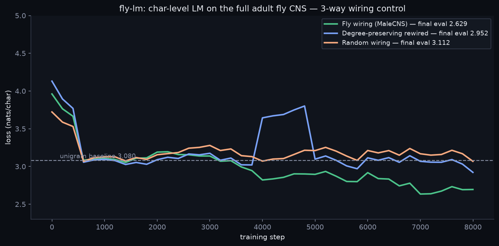

# fly-lm: Can a Fly Brain Learn Language?

**Full adult fly CNS connectome as a fixed recurrent architecture for char-level language modeling — trained from scratch.**

> 한 마디로: 초파리 수컷 전체 중추신경계(MaleCNS v1.0)의 실제 배선을
> 고정된 순환신경망 구조로 쓰고, TinyStories로 다음 글자 예측만 학습시켰다.
> 결과는 반전이었다 — 배선도를 섞어도, 시냅스 굵기를 섞어도 잘 배웠다.
> **둘 다 섞어야만 망했다.**

## Final results — 5-way rewiring × 3 seeds (fair eval seed 123, nats/char)

| Wiring | seeds | mean±std | what's preserved |
|---|---|---|---|
| **WSHUF** | 2.074 / 2.119 / 2.054 | **2.082 ± 0.033** | topology only (weights shuffled) |
| **MWS** | 2.182 / 2.165 / 2.088 | **2.145 ± 0.050** | per-node weight allocation only |
| FLY | 2.332 / 2.244 / 2.099 | 2.225 ± 0.118 | everything (original) |
| MASLOV | 2.569 / 2.497 / 2.584 | 2.550 ± 0.047 | degree distribution only |
| RANDOM | 3.112 / 2.793 / 2.545 | 2.816 ± 0.284 | nothing (σ = highest!) |
| unigram | — | 3.080 | baseline |



*5개 배선 × 3시드 학습곡선 — 얇은 선=개별 시드, 굵은 선=이동평균. WSHUF(초록) 전 구간 최하단, RANDOM(보라)이 시드별로 부채꼴.*

## Core findings

1. **OR-recovery / AND-collapse**: topology and weight-allocation are *independent sufficient conditions* — destroying either one alone leaves learnability intact (WSHUF 2.082 / MWS 2.145); destroying both (MASLOV 2.550) is the only way to break it. Matches the *degeneracy* concept (Tononi–Sporns–Edelman 1999) — here shown as a two-factor manipulation on trainability.
2. **The original is 3rd of 5** — the biological weight layout acts as an *optimization burden* at this budget (WSHUF beats FLY, t=-2.02; FLY σ=0.118 is 3.5× WSHUF's). "Good wiring" ≠ "easy wiring".
3. **Structure buys reliability, not just mean performance**: RANDOM has the highest seed variance (σ=0.284) — structureless wiring gambles on initialization. MASLOV is consistently mediocre (σ=0.047).
4. **State-level exposure bias** (S4): only the real connectome collapses under stateful BPTT — a shortcut conditioned on hidden-state trajectory statistics (cold teacher-forced CE 5.7–6.6 vs unigram 3.08, 'e' 82–97%). Degree-preserving null stays healthy (2.599). Warming up to 5,000 chars does not recover → not hidden memory, but distribution-conditioned shortcut.
5. **Methodological correction**: degree-preserving (Maslov–Sneppen) nulls destroy topology AND weight-hub correlation simultaneously. Claims of "topology effects" built on such nulls are confounded — WSHUF/MWS isolate the two factors.
6. **Where it sits**: char-level n-gram ladder on TinyStories (our measurement): unigram 3.081 / bigram 2.297 / trigram 1.683. FLY (2.225) sits at bigram level with ~1/10 the exposure; the ceiling tracks the TBPTT-32 window.

## 실험 설정

- **커넥톤**: MaleCNS v1.0 (brain + nerve cord, 수컷 성충 전체 CNS)
  - 그래프: 뉴런 211,577 / 연결 10,653,945 (weight≥3 컷) / 시냅스 합 1.25억
  - E/I 부호: 신경전달물질 예측 매핑 (+21.16M/−4.87M 시냅스)
  - 셀타입 11,752종 → 타입쌍 α (FLY 1.52M — 재배선 시 쌍 국소성 파괴로 4.9M까지 증가, Methods에서 교란 명시)
  - 허브: in-degree 중앙값 27, 최대 9,193; strength 상위 1%가 전체 무게의 20.35%
- **모델**: leaky-RNN h←0.5h+0.5tanh(Wh+b), τ=0.5, clamp ±10. 학습: α(쌍별 스케일 [0,3]) + type_bias + sensory 임베딩(107→256) + motor readout(512→107). 그래프 동결.
- **과제**: TinyStories 60M chars, char-level next-token (vocab 107)
- **학습**: Adam 1e-3, B=2, truncated BPTT (warm 32 + train 32), 20k steps, 시드 3회
- **5-way 대조** (같은 엣지 수·가중치 다중집합·E/I 비율·학습 설정):
  - FLY 원본 / MASLOV 차수보존 재배선 / MWS strength보존 재배선(같은 클래스 내 스왑) / WSHUF 위상고정+가중치만 셔플 / RANDOM 완전재배선
  - 그래프 생성·검증: `make_controls.py`, `maslov_rewire.py` (per-node in-degree/in-strength 완전일치 검증 포함)

## 스테이지 히스토리

| Stage | 내용 | 결과 |
|---|---|---|
| 0 | 유충 2,952뉴런 스모크 (CPU) | 파이프라인 검증 |
| 1 | flyvis visual 45,669 + 무작위 대조 | 무작위 2.88 < 파리 3.09 — 시각 커넥톤은 언어에 부적합 (예외 케이스) |
| 2 | MaleCNS 전체 3-way 8k | FLY 2.629 > MASLOV 2.952 > RANDOM 3.112 |
| 2.6 | 20k 장기학습 | FLY 2.332 vs MASLOV 2.569 — 격차 유지 |
| 4 | stateful BPTT + 경계정렬 | FLY만 h=0 붕괴('e' 97%) — state-level exposure bias 발견 |
| 5 | 경계정렬 단독 | FLY 2.327 — 붕괴의 필요조건은 stateful |
| 6 | 시드 3회 반복 | FLY 2.225±0.118 vs MASLOV 2.550±0.047 (완전분리) |
| 7 | **MWS: strength 보존 재배선** | **2.145±0.050 — 원복! 위상 파괴해도 무게 배치만 남으면 회복** |
| 8 | **WSHUF: 위상 보존 + 가중치 셔플** | **2.082±0.033 — 전체 최저. 무게 배치 파괴해도 위상만 남으면 회복+** |
| 8b | RANDOM 3시드 | 2.816±0.284 — 최고 분산, "구조=신뢰도" 발견 |

## 샘플 (학습에 따른 진화)

```
8k:   Once upon a time ar"e. o'n ryol lolded...
20k:  ...the thed int he whend tered wund the terind ger and he nre wo nteot ad und id...
최종:  Once upon a time etreid. He wad. He ke wa ar. He il ut ag sal aad an fa ad ake and.""
       She. foked hare wavig t aadpe at lovhe so...
```

철자 오류 많지만 관사·구두점·대화체 리듬 형성. 전체 타임랩스: `fly20k_results.json`의 `snapshots`.

## 저장소 구성

```
prep_malecns.py      MaleCNS feather → npz 전처리
celltype_model.py    셀타입 쌍별 α 모델
maslov_rewire.py     Maslov–Sneppen 차수보존 재배선 + 검증
make_controls.py     WSHUF / RANDOM 그래프 생성 (seed 888/999, 검증 포함)
vast_hunt.py         Vast.ai 자동 헌팅 (SSH 프록시 장애 대응)
dashboard.py         실시간 학습 대시보드
s6_*_results.json    5-way × 3시드 최종 수치 + losses
train_s6_*.log       학습 로그
PAPER_KO.md          논문 한국어 전문 초안
PAPER_SKELETON.md    논문 골격 (영문 전환용)
```

## 재현

```bash
python3 -m venv .venv && source .venv/bin/activate
pip install torch numpy pandas pyarrow matplotlib
# 커넥톤: MaleCNS v1.0 (CC BY 4.0)
#   https://storage.googleapis.com/flyem-male-cns/v1.0/connectome-data/flat-connectome/connectome-weights-male-cns-v1.0-minconf-0.5.feather
# 데이터: https://huggingface.co/datasets/roneneldan/TinyStories
python prep_malecns.py    # → malecns_graph.npz
python maslov_rewire.py   # → malecns_maslov.npz
python make_controls.py   # → malecns_wshuf.npz, malecns_random.npz
# 학습: /tmp/vast_s6.sh 참조 (B2/TBPTT32, 20k steps, ~$0.4/런)
```

16GB GPU 한 장이면 충분 (~9.7GB 사용). 런당 ~$0.4.

## 학계 위치

- 위상 이점 주장: Suárez 2021 (인간 macro reservoir) — 본 결과는 이를 **설정 의존적으로 재해석**: 가중치를 학습하는 설정에서는 위상도 무게 배치도 단독 충분조건
- Reservoir "위상 무관성": Rodan–Tiňo 2010 (단순 사이클 ESN) — 우리의 신규는 이인자 AND-붕괴 패턴 + 훈련 기반 측정
- Degeneracy: Tononi–Sporns–Edelman 1999, Price–Friston 2002 — 개념의 조작적 이인자판
- 근접 선행 (반드시 인용·비교): larval fly 선형 연산자 분해 (arXiv 2606.17745), C. elegans 섭동 배터리 (arXiv 2609.07355)
- 상세: `LITERATURE.md`

## 라이선스·데이터

- 코드: MIT
- MaleCNS v1.0: CC BY 4.0 (Janelia)
- TinyStories: CC BY 4.0 (Microsoft)

## 한계 (정직하게)

- 절대 성능은 bigram 수준 — 상한은 TBPTT-32 수용창과 정합 [추론]
- 시드 분산 비대칭(FLY vs MASLOV)은 n=3으로 유의하지 않음 — 평균 격차만 주장
- WSHUF 우위(t=-2.02)도 n=3 탐색적 수준; 100k 연장 런에서 역전 가능성 미배제
- α 파라미터 수가 재배선 조건에서 3.2배 증가하는 교란 — WSHUF-FLY 비교만 동일-α로 깨끗
- 단일 과제(char-LM), 학습량 TinyStories 원논문의 0.001% — 심한 데이터 기아 상태
- "파리 뇌가 언어를 이해한다"가 아님 — 커넥톰 구조의 trainability를 언어 과제로 측정한 것

## 로드맵

- [x] 3-way → 5-way 대조 × 3시드 완결
- [x] stateful BPTT 붕괴 발견 + 반증 실험
- [x] n-gram 사다리 측정 (unigram/bigram/trigram)
- [ ] Related Work: 경쟁 논문 2편 정독·비교 서술
- [ ] TBPTT 128 수용창 확장 — "위상은 긴 문맥에서 다시 유의해지는가"
- [ ] 100k 연장 — WSHUF 우위의 예산 의존성 확인
- [ ] word-level 500단어 제한 코퍼스
- [ ] arXiv 프리핀트 → ICLR 2027 워크숍 (Re-Align 계열, ~2/1 마감)
